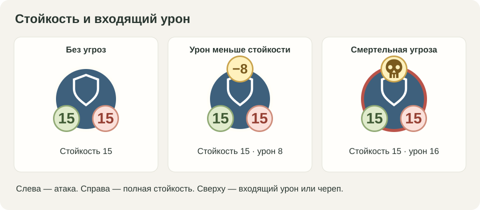
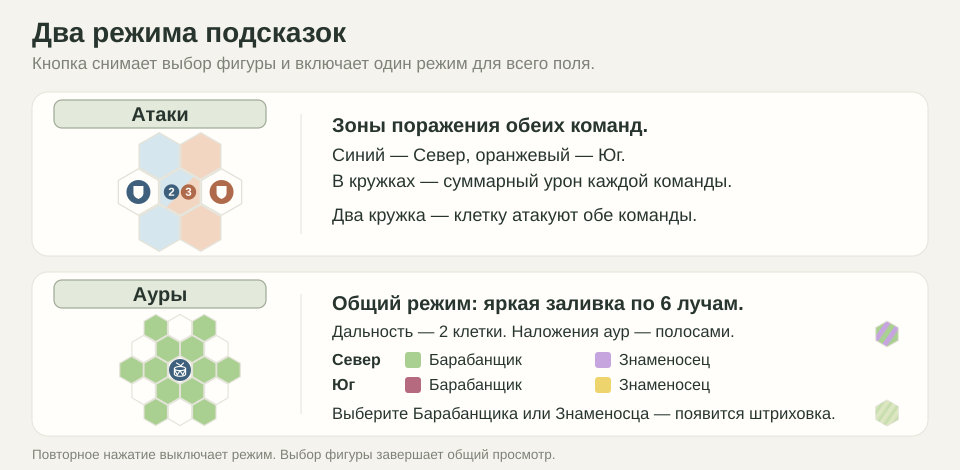
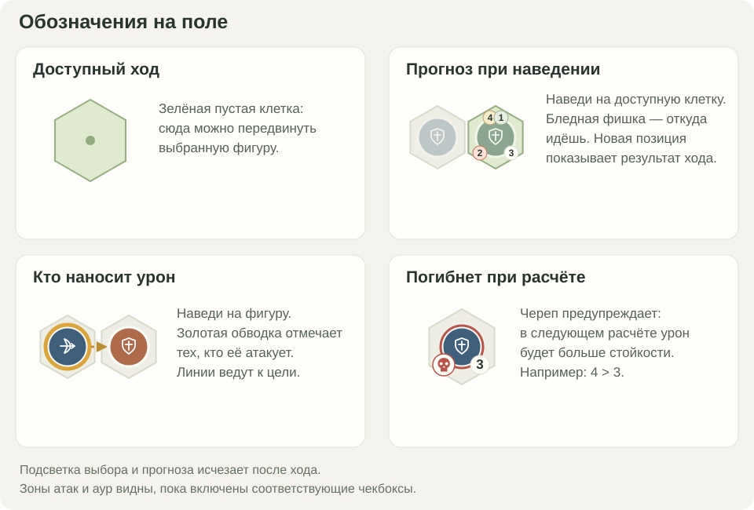

# Game Of Trows

**[Играть в браузере](https://oladii.github.io/GameOfThrows/)** — откройте ссылку и начинайте партию. Устанавливать ничего не нужно.

Пошаговая тактическая игра на клетчатом поле: построение и взаимное усиление фигур решают исход боя. Доступны игра против бота и игра вдвоём на одном экране.

## Как играть

1. Выберите режим, сторону, первый ход и начальную позицию, затем нажмите «Начать».
2. Нажмите на свою фигуру, затем на подсвеченную пустую клетку. После перемещения бой обеих сторон рассчитывается автоматически.
3. Броненосец прикрывает союзников и сражается вблизи; Лукарь атакует на расстоянии; Знаменосец усиливает урон и дальность; Командир повышает стойкость союзников.
4. «Об игре» объясняет правила. Кнопки ← и → показывают последний ход и возвращают текущую позицию; «Отменить» откатывает ход. «Новая игра» открывает подготовку следующей партии.

Для собственной расстановки выберите «Кастом» и «Настроить позицию», расставьте фигуры и нажмите «Готово». Настройки правил доступны через ⚙. Позицию можно сохранить и загрузить в JSON.

В карточках Севера и Юга иконки показывают, сколько фигур каждого типа осталось. Слева приведены базовые характеристики и бонусы аур.

В шапке указаны версия, время сборки и «Сайт» или «Локально». По этим значениям можно сравнить локальную и опубликованную сборки.

## Кружки у фигур

Сверху — собственные урон и дальность. Снизу — входящий урон и стойкость. Если урон больше стойкости, входящий урон заменяется черепом.



## Чекбоксы под полем

«Атаки» показывает обе стороны; числа появляются, когда фигура не выбрана. «Ауры» показывает все области поддержки цветной штриховкой поверх подсветки клеток, «Координаты» — адреса клеток. При выборе Командира или Знаменосца его аура видна и без галочки; наведение на доступную клетку показывает будущую ауру.



## Подсветка и прогноз

Выберите фигуру, чтобы увидеть доступные ходы. Наведите на клетку для прогноза или на фигуру, чтобы увидеть её атакующих.



## Игра без интернета

[Скачайте репозиторий ZIP](https://github.com/Oladii/GameOfThrows/archive/refs/heads/main.zip), распакуйте его и откройте `Lamps.html` в браузере. Игра и код бота встроены в этот файл; сервер не нужен.

## Разработка

Нужен Node.js 22 или новее. Внешних зависимостей нет, `npm install` не требуется.

```sh
npm start      # локальный сервер: http://127.0.0.1:5177
npm run build  # обновить Lamps.html и docs/index.html
npm test       # проверки игровой логики и бота
```

Исходники интерфейса и движка находятся в `dist/`, тесты — в `tests/`. Сборка создаёт одинаковые автономные `Lamps.html` и `docs/index.html`; папка `docs/` предназначена для GitHub Pages.

## Обратная связь

[Создайте issue](https://github.com/Oladii/GameOfThrows/issues), указав браузер, режим игры, шаги воспроизведения, ожидаемый и фактический результат. Если проблема связана с позицией, приложите её JSON или снимок экрана. Впечатления от правил и баланса тоже полезны: опишите, что произошло в партии.
